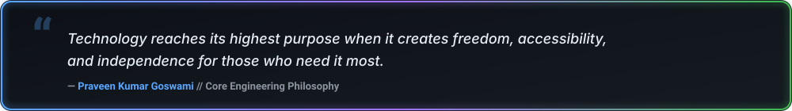
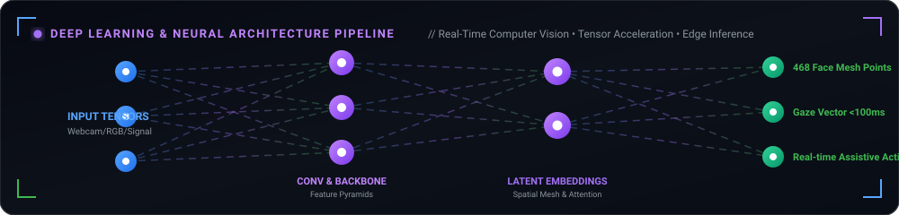
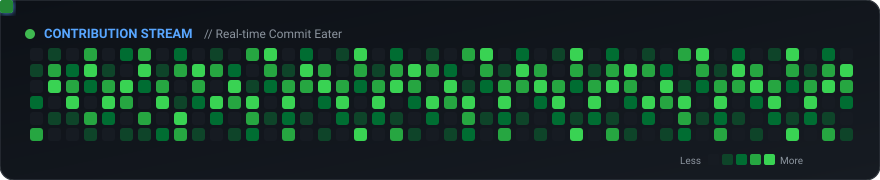

<div align="center">

  <!-- HERO BANNER SVG -->
  <a href="https://github.com/Praveen-Kumar-Goswami">
    
  </a>

  <br/><br/>

  <!-- DYNAMIC ANIMATED TYPING HEADER -->
  <a href="https://github.com/Praveen-Kumar-Goswami">
    
  </a>

  <p align="center">
    <a href="https://github.com/Praveen-Kumar-Goswami">
      
    </a>
    
    
    
  </p>

  <!-- PHILOSOPHY QUOTE CARD -->
  <a href="https://github.com/Praveen-Kumar-Goswami">
    
  </a>

</div>

<br/>

<!-- SECTION: ABOUT ME (CYBER TERMINAL) -->
### ⚡ `whoami --verbose --ai-stack`

```yaml
identity:
  name: "Praveen Kumar Goswami"
  handle: "PraveenJI"
  primary_discipline: "Machine Learning, Deep Learning & Computer Vision Engineer"
  secondary_discipline: "Full-Stack Web Architect (TypeScript, Next.js, Node.js)"
  academics: "BCA (Bachelor of Computer Applications) — IT & Programming"
  location: "India"
  status: "🟢 Open for AI/ML Roles, Deep Learning Research & High-Impact Projects"

deep_learning_focus:
  - "Computer Vision (Gaze Tracking, 468-point Facial Mesh, Object Detection, Real-time Optical Flow)"
  - "Neural Network Optimization (Quantization INT8/FP16, Edge Model Deployment, ONNX Runtime)"
  - "Human-Computer Interaction (Zero-Hardware Vision Interfaces for Motor-Impaired Patients)"
  - "Signal Intelligence & Algorithmic Scan Scheduling (Electronic Warfare Defense Optimization)"

tech_ethos: "Bridging the gap between cutting-edge Deep Learning research and real-world human accessibility."
```


<!-- SECTION: NEURAL PIPELINE ANIMATION -->
### 🧠 Deep Learning Architecture & Neural Pipeline

<div align="center">
  
</div>

<br/>

<!-- SECTION: TECH ARSENAL (COMPREHENSIVE EXPANDED) -->
### 🛠️ Technical Arsenal & Weaponry

<table align="center" width="100%">
  <tr>
    <td align="left" width="28%"><b>🧠 Deep Learning &amp; Neural Nets</b></td>
    <td align="left">
      <a href="https://skillicons.dev">
        
      </a>
      &nbsp;
      
      
      
    </td>
  </tr>
  <tr>
    <td align="left" width="28%"><b>👁️ Computer Vision &amp; Spatial AI</b></td>
    <td align="left">
      <a href="https://skillicons.dev">
        
      </a>
      &nbsp;
      
      
      
      
    </td>
  </tr>
  <tr>
    <td align="left" width="28%"><b>📊 Data Science &amp; Analysis</b></td>
    <td align="left">
      
      
      
      
      
      
    </td>
  </tr>
  <tr>
    <td align="left" width="28%"><b>⚡ Programming Languages</b></td>
    <td align="left">
      <a href="https://skillicons.dev">
        
      </a>
    </td>
  </tr>
  <tr>
    <td align="left" width="28%"><b>🌐 Full-Stack &amp; Modern Web</b></td>
    <td align="left">
      <a href="https://skillicons.dev">
        
      </a>
    </td>
  </tr>
  <tr>
    <td align="left" width="28%"><b>🗄️ Databases &amp; Cloud Storage</b></td>
    <td align="left">
      <a href="https://skillicons.dev">
        
      </a>
    </td>
  </tr>
  <tr>
    <td align="left" width="28%"><b>⚙️ DevOps, Edge AI &amp; Tooling</b></td>
    <td align="left">
      <a href="https://skillicons.dev">
        
      </a>
      &nbsp;
      
      
    </td>
  </tr>
</table>


<!-- SECTION: MACHINE LEARNING & DEEP LEARNING PILLARS -->
### 🔬 Machine Learning &amp; Deep Learning Research Domains

<table>
  <tr>
    <td width="33%" valign="top">
      <h4>👁️ Neural Vision &amp; Spatial Tracking</h4>
      <p>
        Building ultra-low-latency computer vision pipelines that perform real-time facial landmark triangulation, iris center computation, and corneal reflection analysis.
      </p>
      <ul>
        <li><b>MediaPipe 468-point</b> face mesh</li>
        <li>Sub-100ms real-time gaze estimation</li>
        <li>Kalman filtering for jitter suppression</li>
      </ul>
    </td>
    <td width="33%" valign="top">
      <h4>⚡ Edge Model Optimization</h4>
      <p>
        Compressing deep neural networks for deployment on resource-constrained consumer hardware with zero specialized GPUs.
      </p>
      <ul>
        <li>Post-training quantization (INT8 / FP16)</li>
        <li>ONNX Runtime acceleration</li>
        <li>Mobile &amp; Browser inference via WebAssembly</li>
      </ul>
    </td>
    <td width="33%" valign="top">
      <h4>📡 Signal &amp; Algorithmic AI</h4>
      <p>
        Formulating intelligent heuristics and machine learning algorithms for complex spatial and frequency optimization problems.
      </p>
      <ul>
        <li>Electronic Warfare frequency strategies</li>
        <li>Heuristic scan pattern optimization</li>
        <li>Signal interception detection</li>
      </ul>
    </td>
  </tr>
</table>


<!-- SECTION: FEATURED HIGH-IMPACT PROJECTS -->
### 🌟 Featured High-Impact Projects

<table>
  <tr>
    <td width="50%" valign="top">
      <h3>👁️ <a href="https://github.com/Praveen-Kumar-Goswami/Control-with-Eye">EyeControl — Neural Assistive Tech</a></h3>
      <p>
        Real-time assistive computer navigation driven completely by eye movements for individuals suffering from paralysis, ALS, or quadriplegia.
      </p>
      <ul>
        <li><b>No Expensive Hardware:</b> Runs on any standard 720p/1080p RGB webcam.</li>
        <li><b>Computer Vision Pipeline:</b> 5-point corneal calibration extracting exact gaze angles.</li>
        <li><b>Sub-100ms Latency:</b> Zero-perceptible lag cursor tracking enabling digital autonomy.</li>
      </ul>
      <p>
        <code>Python 3.12</code> <code>MediaPipe</code> <code>OpenCV</code> <code>Computer Vision</code> <code>NumPy</code>
      </p>
      <a href="https://github.com/Praveen-Kumar-Goswami/Control-with-Eye"><b>Explore Core Repo »</b></a> •
      <a href="https://github.com/Praveen-Kumar-Goswami/EYE-Control-Part-0.2"><b>Part 0.2 Enhancement »</b></a>
    </td>
    <td width="50%" valign="top">
      <h3>📡 <a href="https://github.com/Praveen-Kumar-Goswami/SIH26055">SmartScan — Electronic Warfare (SIH '26)</a></h3>
      <p>
        Smart Scan Strategy for Electronic Warfare developed for the prestigious <b>Smart India Hackathon (SIH26055)</b>.
      </p>
      <ul>
        <li><b>Dynamic Frequency Scheduling:</b> High-speed spectrum scanning algorithms.</li>
        <li><b>Signal Intelligence:</b> Prioritizing radar and communication frequencies in real-time.</li>
        <li><b>Algorithmic Defense:</b> Resilient architecture for modern defense radar telemetry.</li>
      </ul>
      <p>
        <code>Python</code> <code>Algorithms</code> <code>Signal Analytics</code> <code>Optimization Models</code>
      </p>
      <a href="https://github.com/Praveen-Kumar-Goswami/SIH26055"><b>Explore Repo »</b></a>
    </td>
  </tr>
  <tr>
    <td width="50%" valign="top">
      <h3>🌐 <a href="https://ieee-olive.vercel.app">IEEE Community Platform (Live)</a></h3>
      <p>
        Full-stack interactive portal designed for IEEE community engagement, events, and dynamic knowledge exchange.
      </p>
      <ul>
        <li><b>Modern Architecture:</b> Built with high performance TypeScript &amp; Next.js.</li>
        <li><b>Responsive Design:</b> Seamless experience across mobile, tablet, and desktop viewports.</li>
      </ul>
      <p>
        <code>TypeScript</code> <code>Next.js</code> <code>React</code> <code>TailwindCSS</code> <code>Vercel</code>
      </p>
      <a href="https://ieee-olive.vercel.app"><b>Live Website 🔗</b></a> •
      <a href="https://github.com/Praveen-Kumar-Goswami/IEEE"><b>Source Code »</b></a>
    </td>
    <td width="50%" valign="top">
      <h3>⚔️ <a href="https://mr-samurai.vercel.app">MR-Samurai &amp; Stubiee Ecosystem</a></h3>
      <p>
        High-octane responsive web platforms showcasing modern UI/UX design, state handling, and interactive components.
      </p>
      <ul>
        <li><b>Cutting-Edge Aesthetics:</b> Dark cyber theme, micro-animations, and fluid transitions.</li>
        <li><b>Global Edge Delivery:</b> Optimized bundles deployed globally on Vercel Edge networks.</li>
      </ul>
      <p>
        <code>TypeScript</code> <code>TailwindCSS</code> <code>Vercel Edge</code>
      </p>
      <a href="https://mr-samurai.vercel.app"><b>MR-Samurai Live 🔗</b></a> •
      <a href="https://stubiee.vercel.app"><b>Stubiee Live 🔗</b></a>
    </td>
  </tr>
</table>


<!-- SECTION: GITHUB TELEMETRY & STATS -->
### 📊 GitHub Telemetry & Activity Matrix

<div align="center">
  <table border="0">
    <tr>
      <td>
        
      </td>
      <td>
        
      </td>
    </tr>
    <tr>
      <td colspan="2" align="center">
        
      </td>
    </tr>
  </table>
</div>

<br/>

<!-- SECTION: CONTRIBUTION SNAKE ANIMATION -->
### 🐍 Contribution Stream &amp; Snake Eater

<div align="center">
  <picture>
    <source media="(prefers-color-scheme: dark)" srcset="./assets/github-snake-dark.svg">
    <source media="(prefers-color-scheme: light)" srcset="./assets/github-snake-dark.svg">
    
  </picture>
</div>

<br/>

<!-- SECTION: DAILY DEV QUOTE -->
<div align="center">
  <a href="https://github.com/Praveen-Kumar-Goswami">
    
  </a>
</div>


<!-- SECTION: CONNECT & SOCIALS -->
### 🌐 Connect &amp; Collaborate

<p align="center">
  <a href="https://praveen-kumar-goswami.github.io/portfolio/" target="_blank">
    
  </a>
  &nbsp;
  <a href="mailto:praveenkumarg8e8@gmail.com">
    
  </a>
  &nbsp;
  <a href="https://github.com/Praveen-Kumar-Goswami" target="_blank">
    
  </a>
  &nbsp;
  <a href="https://vercel.com/praveen-kumar-goswamis-projects" target="_blank">
    
  </a>
</p>

<div align="center">
  <sub>Designed &amp; engineered with precision, high-performance SVGs, neural architecture pipelines, and modern web aesthetics.<br/>
  © 2026 <b>Praveen Kumar Goswami</b>. All rights reserved.</sub>
  <!-- GitHub Telemetry: Active | Systems: Operational -->
</div>
